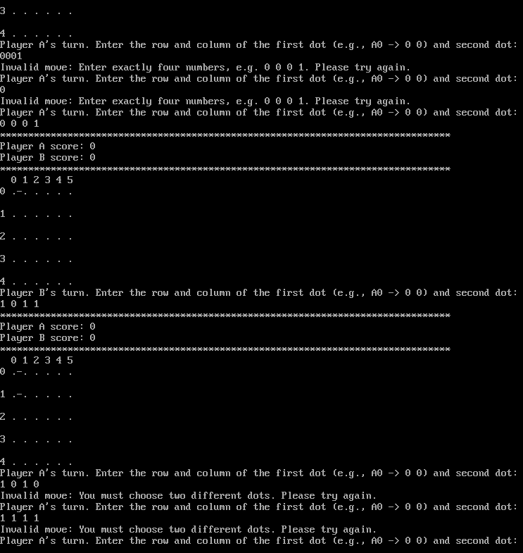
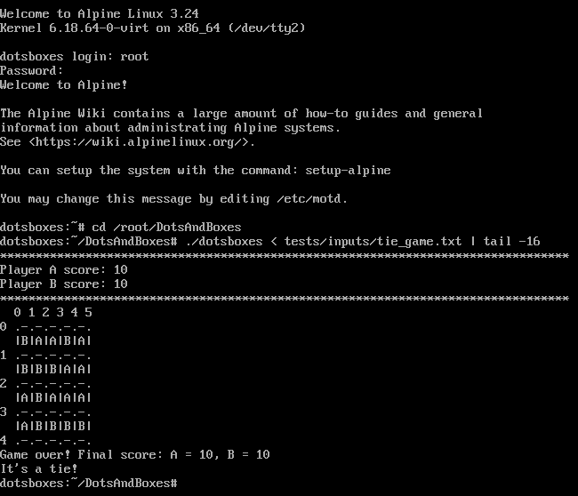

| | |
|---|---|
| **Members** | Wissam Kenaan, Elias El Khoury |
| **GitHub repository** | <https://github.com/WissamKenaan/DotsAndBoxes> |
| **Sprint** | 1: Two-Player Game |

# 1. Overview

We implemented a console-based, two-player version of Dots and Boxes in C.
Players A and B take turns drawing a line between two neighbouring dots on a
grid of 5 × 6 dots (4 × 5 = 20 boxes). A player who completes a box claims it.
The player's initial appears inside the box, and that player moves again. When
all 20 boxes are claimed, the player with more boxes wins, or the game is
declared a tie at 10–10.

The game runs on Alpine Linux inside a virtual machine and starts automatically
at boot, with no username or password prompt.

# 2. Requirements coverage

| Sprint 1 requirement | How it is met | Where |
|---|---|---|
| Display a 4×5 grid of boxes | 5 × 6 dots, rows 0–4, columns 0–5, same layout as the sample run | `display.c` |
| Two players take turns connecting dots | A starts; the turn passes after a move that completes no box | `game.c` |
| Update the board after each move | Score block and board are printed after every legal move | `game.c`, `display.c` |
| Check if a move completes a square and award it | Only the ≤ 2 boxes next to the new line are checked; the owner's initial is stored and shown | `board.c` |
| Declare the winner when all squares are claimed | Winner, or a tie at 10–10 | `game.c`, `display.c` |
| Run on a small Linux distribution without a GUI (Alpine) | Standard C99 and POSIX `sh` only; no external libraries | whole project |
| Launch automatically at VM start, without login | BusyBox `init` + `login -f` + `.profile` | §6, `scripts/player_profile` |
| Multiple `.h` and `.c` files, with a Makefile | 4 modules + `main.c`; targets `all`, `run`, `test`, `valgrind`, `install`, `clean` | `include/`, `src/`, `Makefile` |
| Debug with Valgrind and GDB | Documented sessions, including a real bug found and fixed | §7, `docs/DEBUGGING.md` |
| Everything on GitHub | Source, tests, scripts and docs, committed in phases | §9 |

# 3. Rules taken from the sample run

The project description says that a completed box is awarded, but it does not
say who plays next. The sample run shows it: after Player A completes a box
with `0 3 1 3`, the next prompt is again *"Player A's turn"*. Player B does the
same with `1 4 1 5`. We therefore give the scoring player another turn. This is
also the standard Dots and Boxes rule.

The sample also enters `0 4 0 3`: the second dot is to the left of the first.
The program therefore accepts the two dots in either order.

Some points were not specified, so we made these decisions:

| Unspecified point | Our decision |
|---|---|
| The prompt shows `e.g., A0 -> 0 0`, but all sample input is numeric | Prompt text kept as in the sample; only four integers are accepted |
| Invalid input | Print the reason; the **same** player tries again; the board does not change |
| Tie (10–10 is possible) | Announced explicitly as a tie |
| End of input (Ctrl+D) | Print a message and exit with status 1 instead of looping forever |

# 4. Design

## 4.1 Modules

| Module | Responsibility | Lines (`.h` + `.c`) |
|---|---|---|
| `board` | Board state, move validation, box completion. **No input/output.** | 235 |
| `input` | Read one line safely and parse four integers | 105 |
| `display` | Every `printf` in the program | 145 |
| `game` | Turn order, scores, winner, main loop | 145 |
| `main` | Entry point: `return game_run();` | 9 |

`game` uses `input`, `board` and `display`; the other three modules do not
depend on each other. Keeping the rules free of input/output has two benefits.
The rules can be unit-tested directly, without typing moves. In Sprint 2, the
bot can call the same `board_validate_move` and `board_apply_move` functions,
which guarantees it never makes an illegal move.

## 4.2 Data structures

```c
typedef struct {
    int  horizontal[5][5];  /* line (r,c)-(r,c+1): 1 = drawn */
    int  vertical[4][6];    /* line (r,c)-(r+1,c): 1 = drawn */
    char owner[4][5];       /* 'A', 'B' or ' '                */
    int  claimed_boxes;
} Board;
```

Horizontal and vertical lines are stored separately because they have
different shapes (5 × 5 and 4 × 6), giving 49 lines in total. Box *(i, j)* is
complete exactly when:

```c
horizontal[i][j] && horizontal[i+1][j] && vertical[i][j] && vertical[i][j+1]
```

All game state lives in fixed-size arrays inside one `Game` struct on the
stack. The program never calls `malloc`, so memory leaks are impossible by
design. Valgrind confirms this (§7.2).

# 5. Algorithms and complexity

**Move validation:** O(1). The checks, in order:

1. Both dots are inside the grid.
2. The two dots are different.
3. The dots are neighbours: |Δrow| + |Δcol| = 1. A diagonal neighbour has a
   distance of 2, so it is rejected by the same test.
4. The line is not already drawn. The move is first *normalised* (the
   upper/left dot comes first), so `0 4 0 3` and `0 3 0 4` refer to the same
   array cell.

**Detecting a completed box:** O(1). A new line can only touch two boxes:
above and below a horizontal line, or left and right of a vertical line. We
check only those two, with four array reads each. A simple alternative would
scan all *R × C* boxes after every move, which costs O(R·C). Our approach keeps
the cost constant whatever the board size. It also handles a double completion
naturally: both neighbouring boxes are checked, and each one is awarded.

| Operation | Time |
|---|---|
| Validate a move | O(1) |
| Apply a move and detect completed boxes | O(1) |
| Check whether the game is over (`claimed_boxes == 20`) | O(1) |
| Print the board | O(R·C) |

# 6. Running on Alpine Linux and starting at boot

Alpine does not use systemd. Its virtual consoles are started by BusyBox
`init`, which reads `/etc/inittab`. By default, tty1 runs a `getty` that asks
for a username and password. We replaced that line with:

```
tty1::respawn:/bin/login -f player
```

- `login -f player` logs in the unprivileged user `player` **without asking
  for a password**. We do not use `root`, so a player at the keyboard cannot
  damage the system.
- `respawn` makes `init` restart the login whenever it ends.
- `/home/player/.profile` (our `scripts/player_profile`) runs on tty1 only. It
  clears the screen, starts `/usr/local/bin/dotsboxes`, waits for Enter at the
  end of the game, then logs out. `init` respawns the login, so a new game
  starts.
- tty2–tty6 keep normal login prompts for administration (Alt+F2).

**A problem we found:** BusyBox `login` rejects a locked account (one whose
password field starts with `!` or `*`) even with `-f`. We confirmed this by
reading BusyBox's `loginutils/login.c`. Because `adduser -D` creates the user
without a password, we give `player` a password with `passwd player`, which
unlocks the account. Nobody ever has to type it.

We verified the configuration by rebooting the VM: it starts directly in the
game on tty1 with no login prompt (Figure 6), while tty2 still offers a normal
root login (Figure 8). Figure 5 shows the configuration itself.

**Test environment:** Alpine Linux 3.24 (kernel 6.18, x86_64) in an Oracle
VirtualBox VM with 1 GB of RAM and an 8 GB disk; gcc 15.2.0, GNU Make 4.4.1,
GDB 16.3 and Valgrind 3.25.1, installed with
`apk add build-base gdb valgrind git`. The full step-by-step commands are in
`docs/ALPINE_SETUP.md`.

# 7. Debugging strategy

Everything is compiled with `-g -O0`. `-g` adds debug symbols, so GDB and
Valgrind can show file and line numbers. `-O0` disables optimisation, so every
variable is visible in GDB and lines run in source order. Every debugging run
reads its moves from a file in `tests/inputs/`, so any session can be repeated
exactly.

## 7.1 GDB

**Following a move through the code (Figure 3).** We set a breakpoint on
`board_apply_move` and ran the game with the tie-game moves as input. GDB
stopped on the first move, and `print move` showed `{r1 = 4, c1 = 4, r2 = 4,
c2 = 5}`, which is exactly the first line of the input file, played by
`player = 65 'A'`. We stepped with `next` and used `finish` to return to the
caller (`game_play_move`, `game.c:23`). It printed *Value returned is 0*: the
first move completes no box, which is correct.

**Conditional breakpoint and call stack (Figure 4).** The breakpoint
`break try_claim_box if board->claimed_boxes == 19` skips the whole game and
stops just before the last box is claimed. GDB stopped with `box_row = -1`:
Player B had drawn a line on the top edge, and the code was checking the
"box above" it, which does not exist. The range check on `board.c:127` rejects
it, so there is no out-of-bounds access. `backtrace` shows the call chain
`main → game_run → game_play_move → board_apply_move → try_claim_box`.
`print board->owner` printed `{"BAA A", "BBBAA", "ABAAA", "ABBBB"}`:
19 owned boxes and one space, the last box about to be claimed.

**Showing that our tests and GDB catch a real logic error.** While reviewing
the tests, we noticed that every box in them was completed by a *vertical*
line. A bug in the "box above a horizontal line" calculation would therefore go
unnoticed. We added a test that completes a box with each of its four sides
drawn last. Then we deliberately planted that bug, computing the box above with
row `r` instead of `r − 1`:

```c
completed += try_claim_box(board, m.r1, m.c1, player);   /* WRONG: should be m.r1 - 1 */
```

The new test failed with
`FAIL bottom side drawn last completes the box above it`.
In GDB we stopped on exactly that move:

```
(gdb) break board_apply_move if move.r1 == 2 && move.c1 == 2 && move.r2 == 2 && move.c2 == 3 && player == 66
(gdb) run
(gdb) break try_claim_box
(gdb) continue
Breakpoint 2, try_claim_box (board=..., box_row=2, box_col=2, player=66 'B')
(gdb) continue
Breakpoint 2, try_claim_box (board=..., box_row=2, box_col=2, player=66 'B')
```

Both calls checked box row 2, so box (1, 2) above the line was never examined.
Restoring `m.r1 - 1` made all 45 tests pass again.

## 7.2 Valgrind

```
valgrind --leak-check=full --show-leak-kinds=all --track-origins=yes \
         --error-exitcode=1 ./dotsboxes < tests/inputs/tie_game.txt
```

Result on the Alpine VM for a full 49-move game (Figure 1):

```
total heap usage: 0 allocs, 0 frees, 0 bytes allocated
All heap blocks were freed -- no leaks are possible
ERROR SUMMARY: 0 errors from 0 contexts (suppressed: 0 from 0)
```

Our program never calls `malloc`, and Alpine's C library (musl) does not
allocate any memory for `stdin`/`stdout` here either, so Valgrind counts zero
heap allocations. On our Ubuntu development machine (glibc), the same run shows
2 allocations and 2 frees. Those are glibc's own stdio buffers, freed at exit.
Both runs report **0 errors and no leaks**. We got the same result for the
other game files, the invalid-input file and the unit-test program.

To show that `--track-origins` works, we temporarily removed
`claimed_boxes = 0;` from `board_init`. Valgrind then reported
*"Conditional jump or move depends on uninitialised value(s)"* at the game
loop's `while` condition (`game.c:90`), with the origin in `game_run`'s stack
frame (`game.c:83`). Following `game_is_over → board_is_full → claimed_boxes`
leads to the missing line. We restored it, and Valgrind reported 0 errors.

## 7.3 Defensive input handling

- `fgets` reads at most 127 characters, so the buffer can never overflow.
  Longer lines are discarded entirely, so leftover text is not read as the next
  move.
- `strtol` (not `scanf("%d")`) detects missing numbers and trailing text, and
  handles very large numbers without undefined behaviour.
- Every error message tells the player what to do next. Figure 7 shows this on
  the VM: `0001` and `0` are rejected as "Enter exactly four numbers", and
  `1 0 1 0` as "You must choose two different dots". The same player is asked
  again each time, and the board is unchanged.

# 8. Testing

`make test` runs both test suites.

**Unit tests:** 45 checks in `tests/test_board.c`. They cover:

- **Every validation error:** out of range, same dot, diagonal, two dots
  apart, line already drawn (in both orders).
- **Box completion:** single box; a box completed by each of its four sides;
  double-box completion.
- **Game state:** full board (49 lines → exactly 20 boxes); turn passing;
  extra turn after scoring; winner and tie.
- **Input parsing:** wrong count of numbers, letters, `A0` style, empty line,
  numbers too large for an `int`.

**Full-game tests:** 9 checks in `tests/run_tests.sh`. They play complete games
through the real executable:

| Input file | Result checked |
|---|---|
| `tie_game.txt` (49 moves, 4 double-box moves) | A = 10, B = 10, "It's a tie!" |
| `a_wins_game.txt` (49 moves, 5 double-box moves) | A = 19, B = 1, "Player A wins!" |
| `b_wins_game.txt` (49 moves, 4 double-box moves) | A = 1, B = 19, "Player B wins!" |
| `invalid_input.txt` | 11 rejected inputs, then a clean exit (status 1) |

The expected results were computed by a **separate simulator** written in
Python, not by our C program. The tests therefore compare the C program
against an independent reference instead of against itself.

**Results:**

| | Alpine VM (gcc 15.2, musl) | Ubuntu dev machine (gcc 13.3, glibc) |
|---|---|---|
| Compiler warnings (`-std=c99 -Wall -Wextra -pedantic`) | 0 (Figure 2) | 0 |
| Unit tests | 45/45 pass (Figure 1) | 45/45 pass |
| Full-game tests | 9/9 pass (Figure 1) | 9/9 pass |
| Valgrind | 0 errors, no leaks (Figure 1) | 0 errors, no leaks |

The end of the tie game is shown in Figure 8.

# 9. Version control

The repository was built up in phases, with one commit per module: skeleton
and Makefile; line endings; board; display; input; game loop; tests; Alpine
configuration; documentation. Commit messages say what changed and why. The
`.gitignore` excludes build output (`build/`, `*.o`, the binaries) and debugger
files, so the repository only contains source code, tests, scripts and
documentation.

**A cross-platform problem we prevented.** Git on Windows converts line endings
to CRLF by default. We tested what this does: with CRLF, `tests/run_tests.sh`
and the auto-start script fail on Linux with syntax errors. We added a
`.gitattributes` file containing `* text=auto eol=lf`, which forces Linux line
endings in every copy of the repository, including copies cloned on Windows.

# 10. Status and limitations

- All Sprint 1 functional requirements are implemented and tested.
- Built, tested and run under Valgrind and GDB on **Alpine Linux 3.24** in
  VirtualBox. Auto-start was verified by rebooting the VM (Figures 1–8).
- Input must be four numbers. Letter notation such as `A0` (mentioned only in
  the prompt example) is not supported.
- Only two human players. The bot is the subject of Sprint 2; the rules module
  is ready to be reused for it.

# Appendix: Screenshots from the Alpine VM

All screenshots were taken in VirtualBox (View → Take Screenshot) on the
Alpine Linux 3.24 VM.





