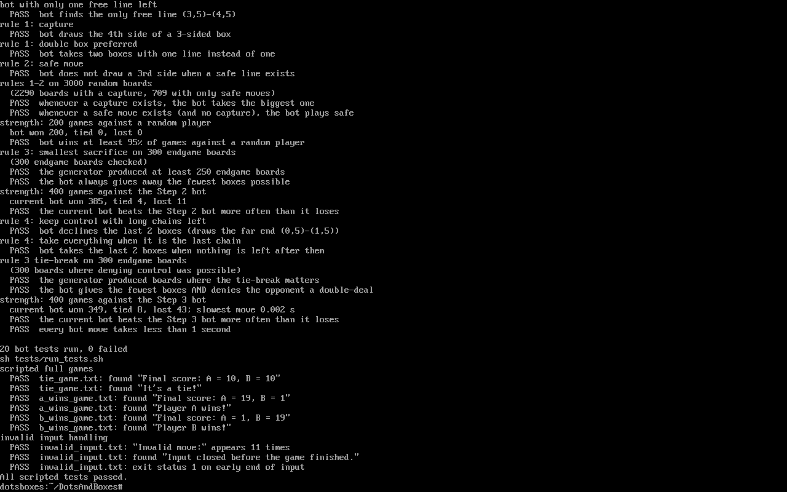
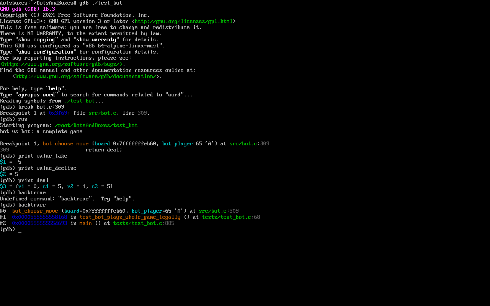
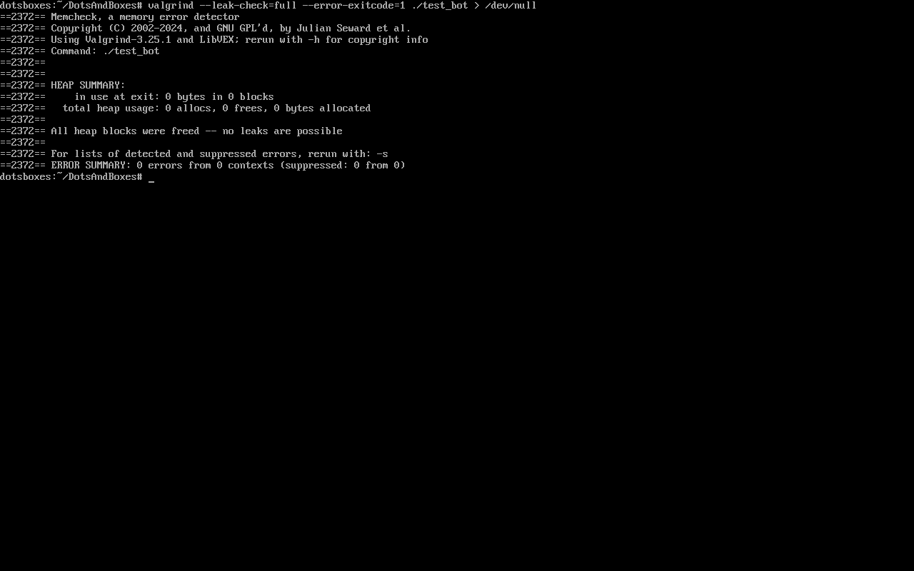

# Sprint 2 review — Dots and Boxes

## Work split

| Member | Implementation and review responsibilities |
| --- | --- |
| Wissam Kenaan | `include/bot.h`, `src/bot.c`, `tests/test_bot.c`, Makefile; hard bot strategy, complexity analysis, bot tests and bot GDB explanation. |
| Elias El Khoury | Menu, human-vs-bot integration, display and game loop; tests other than `test_bot.c`; GitHub workflow; integrated game debugging and VM menu verification. |

This follows the task photo supplied on 25 November 2026. That photo is a
work assignment, not execution evidence. Wissam's bot files and Makefile
are preserved by the integration change.

## Playable game integration — Elias

The start menu offers `1) Two players` and `2) Play against the bot`.
Invalid choices retry, including oversized lines. End-of-input at the menu
exits with status 0. End-of-input during an unfinished game exits with status 1.

In bot mode the human is Player A and the bot is Player B. On B's turn the
game calls `bot_choose_move(&game.board, 'B')`, prints
`Bot (Player B) plays: r1 c1 r2 c2`, and applies that move using
`game_play_move`. Both modes use the same scoring and extra-turn rules.
A scoring bot moves again automatically; a scoring human is prompted again.
The bot is never called after the board is full.

The four existing input fixtures now begin with `1`, preserving their
two-player results. The Python reference tests also send the menu choice.
`bot_game.txt` begins with `2`, then lists all 49 possible edges. Since the
bot can draw a listed edge first, this fixture intentionally allows rejected
duplicate human attempts while still completing a repeatable bot-mode game.

## Testing and debugging

| Check | Scope |
| --- | --- |
| `make test` | 49 existing board/game/input checks, 20 Wissam bot checks, 9 scripted checks. |
| `make test-game` | 107 two-player scenarios; every board, owner, score, turn and final result compared against an independent geometric model. |
| `python3 tests/test_modes.py` | 8 menu/fixture scenarios plus 30 interactive human-vs-bot full games (1,470 legal moves). Checks legal announced bot moves, both players' extra turns, double captures, every displayed board and score, final results and exit status. |
| Valgrind | Tie, both winners, bot-mode fixture and both unit-test binaries. Any detected error fails CI. |
| GDB | Break at `board_apply_move` in two-player mode and at `bot_choose_move` in integrated bot mode; inspect move/player and call stack. |

The workflow remains `.github/workflows/sprint1.yml` to preserve its history,
with the display name **Sprint 1 and 2 Alpine checks**. The integrated code
and expanded workflow passed on commit `fb9ba55` in
[Alpine run #19](https://github.com/WissamKenaan/DotsAndBoxes/actions/runs/45663099548).
This is automated container evidence; it does not establish VM boot behavior.

Observed in that run: all 49 board/game checks, 20 bot checks, 9 scripted
checks, 107 two-player scenarios, and 38 menu/bot scenarios passed. The 30
interactive games covered 28 scoring human moves, 564 scoring bot moves,
and 8 double captures. All six Valgrind invocations reported 0 errors and
0 bytes in use at exit. GDB stopped at `bot_choose_move` with
`bot_player = 66 'B'`, called from `game_run` and `main`.

Wissam's strategy and complexity discussion are in
[BOT_STRATEGY.md](BOT_STRATEGY.md). His strategy unit tests complement the
interactive integration tests; they measure different parts of the system.

## Supplied Alpine evidence — Wissam's bot

These three screenshots were supplied by the team on 25 November 2026 and
preserved without modification. Their captions report what is visible; the
sessions were not independently witnessed during integration. They do not
show the new start menu or a human-vs-bot game through the console game loop.

### Bot and scripted tests

The screenshot shows **20 bot tests, 0 failed**, including capture, safe
move, smallest-sacrifice and chain-control checks. It shows 200 wins in 200
games against a random player, 385 wins / 4 ties / 11 losses against the
Step 2 bot, and 349 wins / 8 ties / 43 losses against the Step 3 bot. The
slowest reported move is 0.002 seconds. The existing scripted game checks
also report success. These are results for the supplied session, not a
guarantee that the bot wins against every human.

### GDB inside the bot

The breakpoint stops in `bot_choose_move` at `src/bot.c:309` while
`./test_bot` runs. The visible values are `value_take = -5`,
`value_decline = 5`, and `deal = {0, 5, 1, 5}`. The successful `backtrace`
shows the bot unit-test call chain. `bot_player` is **A** in this unit test;
the integrated human-vs-bot mode separately uses **B**. The screenshot also
contains a harmless mistyped `backtrcae` command followed by `backtrace`.

### Valgrind on bot tests

The command is `valgrind --leak-check=full --error-exitcode=1 ./test_bot > /dev/null`.
It reports **0 errors**, **0 bytes in use at exit**, and **0 allocations**.
This supports memory correctness for that test run; the updated workflow
also checks the complete integrated game in bot mode.

## VM verification still required for the integrated build

After pulling the integration commit on the Alpine VM, run `make clean`,
`make test`, `make test-game`, `python3 tests/test_modes.py`, and `make install`.
Reboot and confirm tty1 opens the two-choice menu without a login prompt.
Select each mode, finish a game, press Enter through the existing profile,
and confirm the next session opens the menu again. Save fresh screenshots
of the menu at boot and the completed human-vs-bot game before marking this
VM check complete. The supplied bot screenshots do not prove these steps.

## Presentation content — Elias's share

1. **Menu and play:** show the two choices, human A / bot B, an announced bot
   move, and a capture retaining the current player's turn.
2. **Integration checks:** explain why old input fixtures need a leading `1`;
   show the independent model checks for both modes and the final CI result.
3. **Debugging:** show integrated `bot_choose_move` called with B, its
   `game_run` call stack, and Valgrind on the complete bot-mode game.
4. **VM demo:** show the freshly installed menu at boot and the return to
   the menu after finishing. Keep this marked pending until observed.

Use the supplied screenshots above in Wissam's bot-testing/debugging section.
They complement the new menu/integration/VM evidence rather than replacing it.
