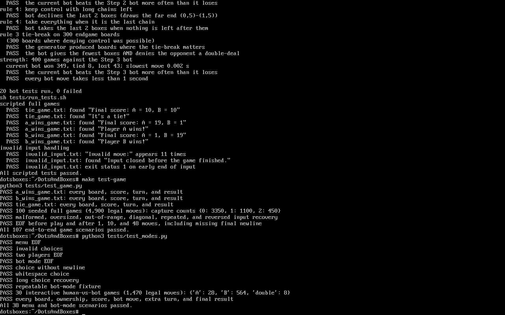
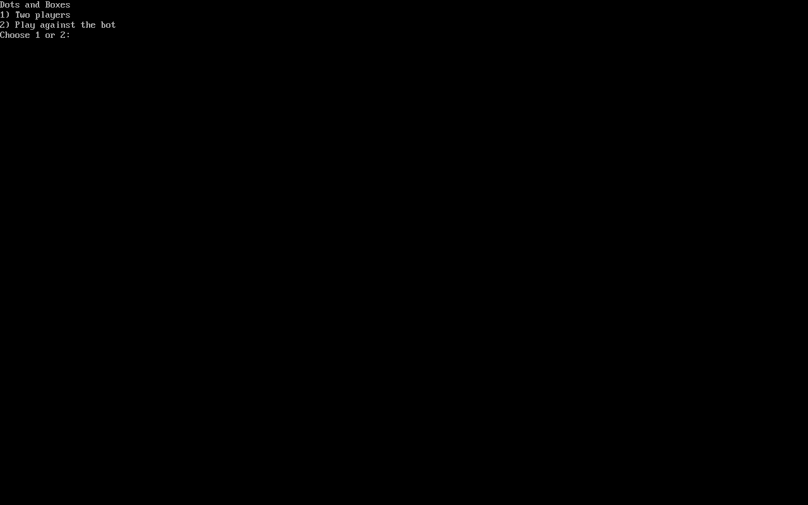
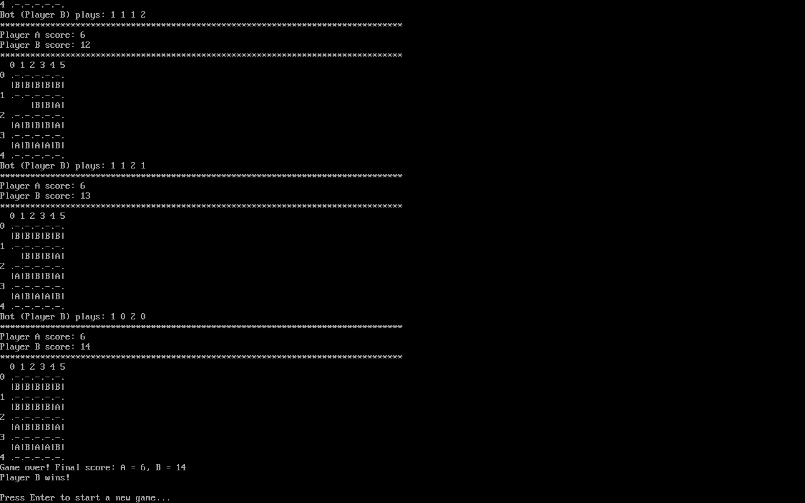

# Sprint 2 review — Dots and Boxes

## Work split

| Member | Implementation and review responsibilities |
| --- | --- |
| Wissam Kenaan | `include/bot.h`, `src/bot.c`, `tests/test_bot.c`, Makefile; hard bot strategy, complexity analysis, bot tests and bot GDB explanation. |
| Elias El Khoury | Menu, human-vs-bot integration, display and game loop; tests other than `test_bot.c`; GitHub workflow; integrated game debugging and VM menu verification. |

This split was agreed on 25 November 2026. Wissam's bot files and Makefile
are unchanged by the integration change.

## Playable game integration — Elias

The start menu offers `1) Two players` and `2) Play against the bot`.
Invalid choices retry, including oversized lines. End-of-input at the menu
exits with status 0. End-of-input during an unfinished game exits with status 1.

In bot mode the human is Player A and the bot is Player B. On B's turn the
game calls `bot_choose_move(&game.board, 'B')`, prints
`Bot (Player B) plays: r1 c1 r2 c2`, and applies that move using
`game_play_move`. Both modes use the same scoring and extra-turn rules.
A scoring bot moves again automatically; a scoring human is prompted again.
The bot is never called after the board is full.

The four existing input fixtures now begin with `1`, preserving their
two-player results. The Python reference tests also send the menu choice.
`bot_game.txt` begins with `2`, then lists all 49 possible edges. Since the
bot can draw a listed edge first, this fixture intentionally allows rejected
duplicate human attempts while still completing a repeatable bot-mode game.

## Testing and debugging

| Check | Scope |
| --- | --- |
| `make test` | 49 existing board/game/input checks, 20 Wissam bot checks, 9 scripted checks. |
| `make test-game` | 107 two-player scenarios; every board, owner, score, turn and final result compared against an independent geometric model. |
| `python3 tests/test_modes.py` | 8 menu/fixture scenarios plus 30 interactive human-vs-bot full games (1,470 legal moves). Checks legal announced bot moves, both players' extra turns, double captures, every displayed board and score, final results and exit status. |
| Valgrind | Tie, both winners, bot-mode fixture and both unit-test binaries. Any detected error fails CI. |
| GDB | Break at `board_apply_move` in two-player mode and at `bot_choose_move` in integrated bot mode; inspect move/player and call stack. |

The workflow remains `.github/workflows/sprint1.yml` to preserve its history,
with the display name **Sprint 1 and 2 Alpine checks**. The integrated code
and expanded workflow passed on commit `fb9ba55` in
[Alpine run #19](https://github.com/WissamKenaan/DotsAndBoxes/actions/runs/45663099548).
The VM boot behaviour was checked separately on our Alpine VM (see below).

Observed in that run: all 49 board/game checks, 20 bot checks, 9 scripted
checks, 107 two-player scenarios, and 38 menu/bot scenarios passed. The 30
interactive games covered 28 scoring human moves, 564 scoring bot moves,
and 8 double captures. All six Valgrind invocations reported 0 errors and
0 bytes in use at exit. GDB stopped at `bot_choose_move` with
`bot_player = 66 'B'`, called from `game_run` and `main`.

Wissam's strategy and complexity discussion are in
[BOT_STRATEGY.md](BOT_STRATEGY.md). His strategy unit tests complement the
interactive integration tests; they measure different parts of the system.

## Alpine VM evidence — bot tests (25 November 2026)

Taken on our Alpine Linux 3.24 VM while the bot was being finished.

### Bot and scripted tests

**20 bot tests, 0 failed**: capture, safe move, smallest sacrifice and chain
control. 200 wins in 200 games against a random player, 385 wins / 4 ties /
11 losses against the Step 2 bot, 349 wins / 8 ties / 43 losses against the
Step 3 bot. Slowest move 0.002 s. All scripted game checks pass.

### GDB inside the bot

Breakpoint at `src/bot.c:309` while `./test_bot` runs: `value_take = -5`,
`value_decline = 5`, `deal = {0, 5, 1, 5}`, so the bot declines the last two
boxes. `bot_player` is A because the bot plays both sides in this unit test;
in the integrated game the bot is B. (A mistyped `backtrcae` is followed by the
correct `backtrace`.)

### Valgrind on the bot tests

`valgrind --leak-check=full --error-exitcode=1 ./test_bot > /dev/null`:
**0 errors**, 0 bytes in use at exit, **0 allocations**.

## Alpine VM verification of the final build (26 November 2026)

On the VM we pulled the final revision, rebuilt it with `make clean && make`,
ran the test suites and installed it with `make install`.

### All test suites on the VM

20 bot tests and all scripted checks pass, **107/107** two-player scenarios
and **38/38** menu and bot-mode scenarios (30 complete human-vs-bot games).

### Menu at boot

After `reboot`, tty1 shows the two-choice menu directly, with no login prompt.

### A complete game against the bot

Mode 2, human A against bot B, played to the end on tty1. The bot announces
each move (`Bot (Player B) plays: ...`) and keeps its turn after scoring.
Final score **A = 6, B = 14**, *Player B wins!*, then the profile's
`Press Enter to start a new game...`.

### Next session

Pressing Enter ends the session; init starts a new one and the menu appears
again.

## Presentation content — Elias's share

1. **Menu and play:** show the two choices, human A / bot B, an announced bot
   move, and a capture retaining the current player's turn.
2. **Integration checks:** explain why old input fixtures need a leading `1`;
   show the independent model checks for both modes and the final CI result.
3. **Debugging:** show integrated `bot_choose_move` called with B, its
   `game_run` call stack, and Valgrind on the complete bot-mode game.
4. **VM demo:** show the menu at boot and the return to the menu after
   finishing a game (Figures 05 to 07).

Screenshots 01 to 03 belong to Wissam's bot section; 04 to 07 to the
integration and VM section.
